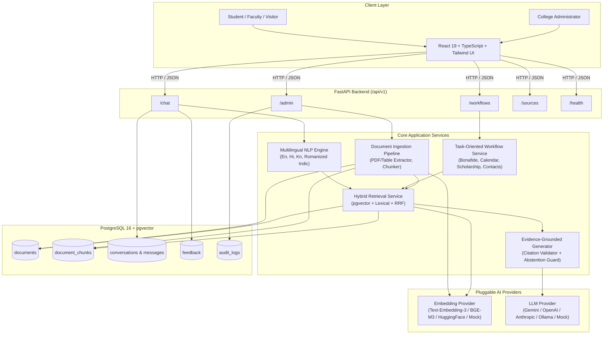

# Phase 1: Repository Assessment, Architecture & Master Implementation Plan
**Project:** RVITM Mitra AI (ಆರ್.ವಿ.ಐ.ಟಿ.ಎಂ ಮಿತ್ರ / आरवीआईटीएम मित्र)  
**System:** Trilingual, Source-Grounded College Information Assistant for R V Institute of Technology and Management (Bengaluru)  
**Date:** October 2026  
**Status:** Completed Phase 1 (Inspection & Planning)

---

## 1. Repository Assessment

### 1.1 Existing State
- **Workspace Directory:** `/Users/sw/Desktop/Nlp Project`
- **Initial Content:** Empty directory (0 files).
- **Environment & Toolchains Detected:**
  - Python: `3.14.6`
  - Node.js: `v26.4.0`
  - npm: `11.17.0`
  - Docker: `29.6.1`
  - Git: Initialized in Phase 1 with comprehensive `.gitignore`.

### 1.2 Gap Analysis & Prerequisites
| Area | Current State | Required State | Action Item |
|------|---------------|----------------|-------------|
| **Source Documents** | No official college documents present | Official RVITM policy handbooks, academic calendars, fee circulars, admission brochures | Create demonstration/sample corpus clearly labelled `DEMO / UNVERIFIED` with ingestion pipelines ready for official PDFs |
| **Database** | None | PostgreSQL 16+ with `pgvector` & full-text search extensions | Docker Compose environment & local fallback configuration (SQLite/Vector fallback for lightweight test running if Docker daemon isn't running) |
| **Backend** | None | FastAPI + Pydantic v2 + SQLAlchemy/pgvector + Pytest | Modular service architecture under `backend/` |
| **Frontend** | None | React + TypeScript + Vite + Tailwind CSS + Lucide Icons | Mobile-first campus UI under `frontend/` |
| **LLM / Embedding Keys** | None | Provider abstraction (OpenAI, Gemini, Ollama, HuggingFace, Local Mock) | Decoupled provider interface supporting offline test doubles, local models, and external APIs |
| **Evaluation Suite** | None | Multilingual benchmark (English, Hindi, Kannada, transliterated/code-mixed) | Benchmark dataset & test runner measuring Recall@K, MRR, Groundedness, Abstention |

---

## 2. Proposed Architecture

RVITM Mitra AI is architected with a strict separation between **untrusted user input / retrieved documents** and **trusted system execution instructions**. The system rejects hallucination by enforcing retrieval relevance thresholds and citation verification before generating final student responses.

```
+----------------------------------------------------------------------------------------------------+
|                                    RVITM MITRA AI - ARCHITECTURE                                   |
+----------------------------------------------------------------------------------------------------+

  [ Student / User / Admin Browser ]
                │
                ▼ (HTTPS / JSON API)
  ┌──────────────────────────────────────────────────────────────────────────────────────────────────┐
  │ FRONTEND (React 19 + TypeScript + Vite + Tailwind CSS)                                           │
  │  - Trilingual UI (English / हिंदी / ಕನ್ನಡ) + Script selector & Unicode fonts                     │
  │  - Interactive Chat with citation chips, expandable source drawer & verification badges         │
  │  - Task-Oriented Workflow modules (Bonafide certificate, exam calendar, scholarship, contacts)    │
  │  - Secure Admin Portal (Document upload, review/approval, analytics, audit log)                 │
  └──────────────────────────────────────────────────────────────────────────────────────────────────┘
                │
                ▼ (REST API /v1)
  ┌──────────────────────────────────────────────────────────────────────────────────────────────────┐
  │ BACKEND API (FastAPI + Pydantic v2)                                                              │
  │  - Middleware: CORS, Request Tracing (X-Request-ID), Rate Limiter, Security Headers, Auth RBAC  │
  │  - Routers:                                                                                      │
  │      /api/v1/chat              -> Trilingual query pipeline                                      │
  │      /api/v1/feedback          -> Student feedback collection & audit                            │
  │      /api/v1/sources/{id}      -> Source document viewer & verification metadata                 │
  │      /api/v1/workflows         -> Step-by-step procedural campus services                        │
  │      /api/v1/admin/*           -> Document approval, reindexing, analytics, FAQ curation         │
  │      /api/v1/health            -> System, DB, vector, and model health status                    │
  └─────────────────────────────────┬────────────────────────────────────────────────────────────────┘
                                    │
    ┌───────────────────────────────┴───────────────────────────────┐
    ▼                                                               ▼
┌──────────────────────────────────────────────┐  ┌──────────────────────────────────────────────────┐
│ MULTILINGUAL NLP & QUERY PROCESSING          │  │ DOCUMENT INGESTION PIPELINE                      │
│ - Language Detection (En, Hi, Kn, Romanized) │  │ - Multi-format extractor (PDF, Scanned, TXT, MD) │
│ - Script Normalization (Indic & Latin)       │  │ - Heading & Semantic Boundary Chunking           │
│ - Code-mixing & Transliteration resolver     │  │ - Metadata enrichment (Effective dates, page, ID)│
│ - Intent & Entity extractor                  │  │ - Multilingual Embedding Generator               │
│ - Ambiguity & Out-of-Domain detector         │  │ - Status: PENDING_APPROVAL -> APPROVED           │
└──────────────────────┬───────────────────────┘  └─────────────────────────┬────────────────────────┘
                       │                                                    │
                       ▼                                                    ▼
┌────────────────────────────────────────────────────────────────────────────────────────────────────┐
│ HYBRID RETRIEVAL & FUSION ENGINE                                                                   │
│  - Dense Semantic Search: pgvector (Cosine / L2 distance on multilingual embeddings)               │
│  - Sparse Lexical Search: PostgreSQL Full-Text Search (tsvector / tsquery with Indic/English stems)│
│  - Reciprocal Rank Fusion (RRF): Combines dense + sparse rankings (k=60)                           │
│  - Filtering: Only `APPROVED` documents within active validity range (`effective_from` to `until`) │
│  - Optional Cross-Encoder Reranker: Multilingual BGE / MiniLM / heuristic scoring                 │
│  - Diagnostics: Retrieval score, chunk coverage, similarity threshold validation                   │
└──────────────────────────────────────┬─────────────────────────────────────────────────────────────┘
                                       │
                                       ▼
┌────────────────────────────────────────────────────────────────────────────────────────────────────┐
│ EVIDENCE-GROUNDED ANSWER GENERATION SERVICE                                                        │
│  - Grounding Guardrails: Strict system prompt separating context from user prompt                  │
│  - Citation Anchor: Maps each assertion to specific `doc_id`, `version`, `section`, `page_number` │
│  - Calibrated Abstention: Explicit fallbacks if retrieval score < threshold or contradictory info  │
│  - Structured Output Validator: Validates answer schema, citations, follow-ups, clarification flag │
│  - Model Provider Abstraction: Gemini, OpenAI, Claude, Groq, Ollama, Deterministic Mock for CI     │
└──────────────────────────────────────┬─────────────────────────────────────────────────────────────┘
                                       │
                                       ▼
┌────────────────────────────────────────────────────────────────────────────────────────────────────┐
│ STORAGE & AUDIT LAYER (PostgreSQL 16 + pgvector)                                                   │
│  - documents (metadata, approval status, validity dates, verified_by)                              │
│  - document_chunks (chunk_text, embedding, section_title, page_number, language, token_count)      │
│  - conversations & messages (session_id, query_lang, response_lang, citations, status)             │
│  - feedback (rating, comment, escalation_flag)                                                     │
│  - audit_logs (admin actions, approval transitions, re-indexing runs)                              │
└────────────────────────────────────────────────────────────────────────────────────────────────────┘
```

---

## 3. Dependency & Interaction Diagram



---

## 4. Required Official RVITM Documents Inventory

To ensure verifiable source grounding, the production deployment will ingest official institutional documents issued by RVITM Bengaluru (an VTU-affiliated institution under the Rashtreeya Sikshana Samithi Trust - RSST). During development, we create an initial demonstration corpus of labelled sample documents mirroring these exact structures:

1. **RVITM Academic Calendar & VTU Regulations** (Semester start/end dates, CIE/SEE schedules, attendance threshold 85% with VTU 75% medical condonation rules).
2. **RVITM Bonafide & Document Application Procedures** (Registrar office procedure, application format, turnaround time, fee details if applicable).
3. **RVITM Anti-Ragging & Campus Code of Conduct** (Committee contacts, helpline numbers, disciplinary procedures, VTU compliance).
4. **RVITM Department Directory & Key Administrative Contacts** (Principal office, HoDs of CSE, ISE, ECE, ME, Training & Placement Officer, Examination Chief Superintendent).
5. **RVITM Library & Information Centre Rules** (Circulation limits, digital library access, timings, book bank scheme).
6. **RVITM Scholarships & Financial Aid Circulars** (SSP Karnataka, National Scholarship Portal, RSST fee concessions, eligibility and deadlines).
7. **RVITM Transportation & Campus Facilities** (Bus routes across Bengaluru, canteen, hostel rules, sports facilities).

> **Policy:** All demo documents will clearly display `[DEMONSTRATION ONLY - PENDING OFFICIAL RVITM VERIFICATION]` in their headers and database metadata.

---

## 5. Detailed Implementation Phases

| Phase | Milestone Name | Scope & Deliverables |
|:-----:|----------------|----------------------|
| **Phase 1** | **Repository Inspection & Master Planning** | Initial assessment, architectural blueprint, master plan, directory scaffold, `.gitignore`, `PROJECT_STATUS.md`. |
| **Phase 2** | **Data Model & Database Schema** | Normalized PostgreSQL models (`documents`, `document_chunks`, `conversations`, `feedback`, `audit_logs`), migrations, vector indexes, connection pooling, and model tests. |
| **Phase 3** | **Document Ingestion Pipeline** | File parsers (PDF, text, markdown, OCR fallback), semantic chunker with page/section preservation, embedding generator, draft vs. approved state workflow, duplicate detection, unit tests. |
| **Phase 4** | **Multilingual Query Understanding** | Language detector (En, Hi, Kn, Romanized), script normalizer, transliteration and code-mixing handlers, intent classification, ambiguity detector, unit test suite. |
| **Phase 5** | **Hybrid Retrieval Service** | pgvector dense search + PostgreSQL full-text search, Reciprocal Rank Fusion (RRF), date and approval filters, reranking interface, retrieval evaluation metrics (Recall@K, MRR). |
| **Phase 6** | **Evidence-Grounded Generation** | Strict system prompt guardrails, source citation extractor, calibrated abstention logic for low confidence/out-of-domain questions, structured output validation, mock and live provider integrations. |
| **Phase 7** | **FastAPI Backend Endpoints** | `/api/v1/chat`, `/api/v1/feedback`, `/api/v1/sources/{id}`, `/api/v1/health`, `/api/v1/admin/*`, rate limiting, CORS, error handling, Pydantic schemas, API tests. |
| **Phase 8** | **Polished Trilingual Frontend** | React 19 + TypeScript + Vite + Tailwind CSS, responsive mobile-first UI, language switch (English, हिन्दी, ಕನ್ನಡ), citations drawer, suggested prompts, feedback UI, admin dashboard. |
| **Phase 9** | **Task-Oriented Campus Workflows** | Structured guided procedures for Bonafide Certificate, Academic/Exam Calendar, Scholarship Assistant, Department Contacts. |
| **Phase 10** | **Admin Dashboard & Verification Portal** | Document upload, text/chunk preview, approval/rejection toggle, re-indexing trigger, unanswered query review, analytics charts. |
| **Phase 11** | **Multilingual Evaluation Suite** | 300+ benchmark questions across En, Hi, Kn, transliteration, out-of-domain, adversarial; evaluation runner measuring Recall@K, Groundedness, Abstention accuracy. |
| **Phase 12** | **Security & Adversarial Hardening** | Prompt injection defenses, SQL injection prevention, safe markdown rendering, file upload sanitization, RBAC validation, privacy audit. |
| **Phase 13** | **Docker & Deployment Automation** | Multi-container Docker Compose (Backend, Frontend, PostgreSQL with pgvector), health checks, `.env.example`, production deployment guide. |
| **Phase 14** | **Deliverables, Verification & README** | Comprehensive documentation, demo scripts, final verification tests across all services, completed `PROJECT_STATUS.md`. |

---

## 6. Definition of Done (DoD) per Phase

Every phase must satisfy:
1. **Code Completeness:** Clean implementation without empty stubs, unresolved placeholders, or hardcoded secrets.
2. **Automated Testing:** Dedicated unit/integration tests running and passing via pytest or npm test.
3. **Traceability:** Grounded citations linking verified document metadata.
4. **Multilingual Support:** Explicit handling of English, Hindi, and Kannada script + Latin transliterations.
5. **Documentation & Status:** Updates committed to `PROJECT_STATUS.md` recording changes, metrics, and test logs.
